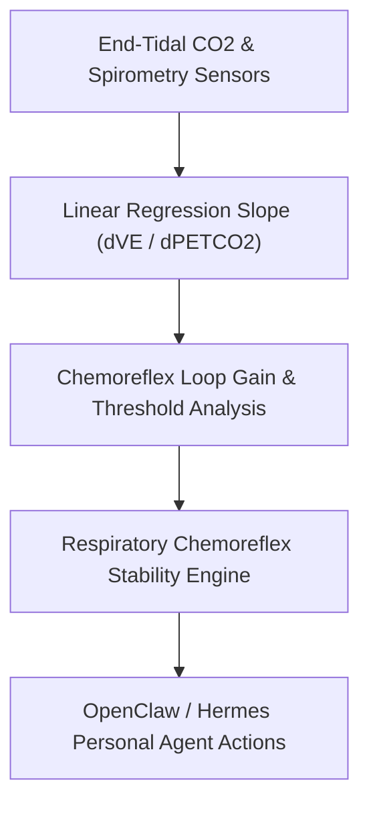

# Hypercapnic Ventilatory Response (HCVR) Skill

[](LICENSE)
[](https://www.python.org/)
[](requirements.txt)
[](mcp_server.py)
[](SKILL.md)

Zero-dependency sovereign personal agent skill for non-invasive evaluation of Hypercapnic Ventilatory Response (HCVR slope), central respiratory chemosensitivity, and CO2 tolerance.



## Features
- **Deterministic Math**: Pure Python standard library implementation with zero external dependencies.
- **Respiratory Physiology Standards**: Implements validated Read rebreathing linear sensitivity slope calculations.
- **Chemoreflex Loop Gain Stratification**: Quantitative evaluation of central controller sensitivity and periodic breathing vulnerability.
- **Model Context Protocol (MCP)**: Native JSON-RPC tool integration for LLMs and autonomous agents.

## Quickstart

```python
from client import RespiratoryChemoreflexClient

client = RespiratoryChemoreflexClient()
result = client.evaluate_hypercapnic_response(
    delta_petco2_mmhg=11.0,
    delta_minute_ventilation_l_min=25.3
)
print("HCVR Slope:", result["hcvr_slope_l_min_mmhg"])
print("Classification:", result["classification"])
```

## License
Apache-2.0
